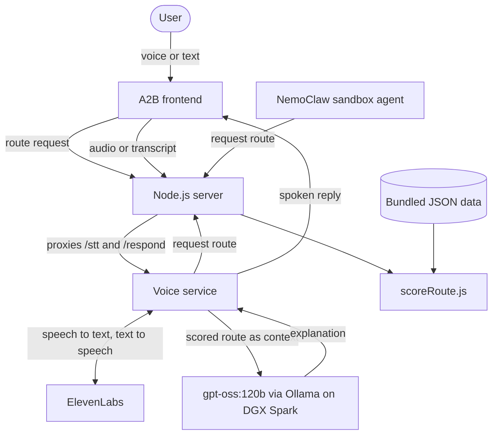

# A2B: Accessibility-First Voice Navigation


**Find the London route you can actually complete, not just the fastest one on paper.**

A2B is a voice-controlled journey assistant for people who need step-free access, working lifts, less walking, or fewer changes. A deterministic engine scores each route. A local LLM on NVIDIA DGX Spark then explains the result in plain language and answers by voice through ElevenLabs. Built by Team NetRunner for the NVIDIA Hack for Impact Challenge.

## Contributors

| Contributor | Role / Feature Ownership |
| --- | --- |
| [akontovskyi](https://github.com/akontovskyi) | Frontend, TfL client, voice server, and server integration |
| [Anj-13](https://github.com/Anj-13) | NemoClaw planner agent, persistent memory, and sandbox tooling |
| [Athar230](https://github.com/Athar230) | Route scoring engine, server, route integration, and demo tooling |
| [Joachimsyh](https://github.com/Joachimsyh) | Speech, LLM client, and conversation memory |
| [shasflippedtea](https://github.com/shasflippedtea) | Route, accessibility, and traffic data, plus data validation |

## Demo

[](https://youtu.be/0z4EGb4q5Hk)

**Links:** [Demo Video](https://youtu.be/0z4EGb4q5Hk) · [Demo Runbook](DEMO_RUNBOOK.md) · [Voice Service](voice_service/README.md) · [Sandbox Agent](sandbox/README.md)

## Table of Contents

- [Project Overview](#project-overview)
- [Key Features](#key-features)
- [Tech Stack](#tech-stack)
- [System Architecture & Project Structure](#system-architecture--project-structure)
- [Getting Started](#getting-started)
- [Usage](#usage)
- [API Reference](#api-reference)
- [Testing & Quality](#testing--quality)
- [Challenges & Solutions](#challenges--solutions)
- [Results](#results)
- [Known Limitations](#known-limitations)
- [Forking This Project](#forking-this-project)
- [License](#license)

## Project Overview

**Problem:** Transport apps usually optimise for speed. A route that looks best on paper can be unusable if it has stairs, a broken lift, or a long walk between platforms.

**Solution:** A2B treats accessibility as the main objective. It penalises routes that a passenger cannot use, even when they are faster, and explains why it chose a route. Because the LLM receives the scored route as authoritative context, it explains the recommendation rather than inventing one.

**Audience / Context:** Wheelchair users and other passengers with access needs travelling in London. Built as a team entry for the NVIDIA Hack for Impact Challenge.

**Project Status:** Prototype. Routes, disruptions, and accessibility data come from bundled sample files covering five London destinations. See [Known Limitations](#known-limitations).

## Key Features

- **Accessibility-first scoring:** Heavily penalises routes without step-free access, lifts, or ramps when the user needs them.
- **Voice or text input:** Speak a request through ElevenLabs speech-to-text, or type it instead.
- **Spoken explanations:** `gpt-oss:120b` explains the chosen route, and ElevenLabs reads the answer aloud.
- **Local inference:** The LLM runs on NVIDIA DGX Spark through Ollama rather than a hosted API.
- **Reroute decisions:** Recommends a change only if the alternative improves the score by at least 8 points, or if the current route is closed and an open alternative exists.
- **Multimodal routes:** Scores walking, cycling, car, bus, Underground, train, and mixed journeys.
- **Personal preferences:** Takes walking limits, cost sensitivity, fewer transfers, and preferred or avoided modes into account, with peak and off-peak train fares.
- **Conversation memory:** Stores earlier turns so that follow-up questions keep their context.
- **Sandboxed planner agent:** A NemoClaw agent uses the same route engine, keeps memory across sessions, and can recall recent events on request.

## Tech Stack

| Layer | Technologies | Purpose |
| --- | --- | --- |
| Frontend | React 18, Leaflet, Babel Standalone | Mobile-style map UI, with no build step |
| Route engine | Node.js 18+ (standard library only) | Scoring, API, static hosting, and voice proxy |
| Voice service | Python, FastAPI, ElevenLabs (Scribe v2 and TTS) | Speech-to-text, text-to-speech, and conversation memory |
| Inference | NVIDIA DGX Spark, Ollama, `gpt-oss:120b` | Local reasoning and explanations |
| Agent sandbox | NemoClaw, OpenClaw, Python | Sandboxed planner agent with persistent memory |
| Data | JSON files | Routes, accessibility, traffic events, and conversation history |
| Testing | `node:test`, Python `unittest` | Engine, API, voice, and agent tests |

## System Architecture & Project Structure



<details>
<summary>View project folder structure</summary>

```text
a2b-accessible-navigation/
├── frontend/                 # React and Leaflet UI, loaded without a build step
├── voice_service/            # FastAPI service: speech, Ollama client, and memory
│   ├── app/
│   └── tests/
├── sandbox/                  # NemoClaw planner agent and persistent memory
├── scripts/                  # Demo preflight check and DGX SSH tunnel
├── explanation/plans/        # Design notes
├── server.js                 # API, frontend hosting, and voice proxy
├── scoreRoute.js             # Route scoring and reroute decisions
├── datashape.js              # Shared route contract and validation
├── dataIntegration.js        # Merges route, traffic, and accessibility data
├── tflClient.js              # TfL API client (not yet connected)
├── serve.py                  # Optional FastAPI server for the JSON data
├── validate_routes.py        # Route data validation
├── route_data*.json          # Sample routes for each destination
├── accessibility_data.json   # Sample accessibility data
├── traffic_events.json       # Sample disruptions
└── DEMO_RUNBOOK.md           # Demo-day setup and recording script
```

</details>

### Notable Design Decisions

- **The LLM explains, and the engine decides:** Route choices come from deterministic code that can be tested and repeated. The trade-off is that the model cannot override the score.
- **A reroute threshold:** The 8-point minimum avoids interrupting someone for a marginal gain. A closure skips the threshold when an open alternative exists.
- **Graceful fallbacks:** Typed input still works if the microphone fails, and the voice service still responds if the route API or Ollama is unavailable.
- **Local inference:** Running the LLM on DGX Spark avoids a hosted LLM. The trade-off is that the full voice demo needs access to the hardware.
- **No frontend build step:** Loading React from a CDN kept hackathon iteration fast, but the app needs internet access and is not production-optimised.

## Getting Started

### Prerequisites

- Node.js 18 or newer
- Internet access for the frontend's CDN libraries and map tiles
- For voice: Python 3.9 or newer, and an [ElevenLabs](https://elevenlabs.io/) API key
- For the LLM: Ollama with `gpt-oss:120b`, running locally or on a DGX Spark

The project has no npm dependencies. The commands below use macOS or Linux syntax, and the `demo:check` and `demo:dgx` scripts need Bash.

### 1. Fork and Clone

[Fork the repository](https://github.com/Anj-13/a2b-accessible-navigation/fork), then clone your copy:

```bash
git clone https://github.com/<your-username>/a2b-accessible-navigation.git
cd a2b-accessible-navigation
```

### 2. Run the App

```bash
npm start
```

**Expected result:** The app and API are available at `http://localhost:3000`.

The server listens on all network interfaces by default. To limit it to your computer, or to change the port:

```bash
HOST=127.0.0.1 npm start
PORT=3001 npm start
```

### 3. Configure Voice (Optional)

Skip this step if you only need route recommendations.

```bash
python3 -m venv voice_service/.venv
source voice_service/.venv/bin/activate
python3 -m pip install -r voice_service/requirements.txt
python3 -m pip install fastapi uvicorn python-multipart
cp voice_service/.env.example voice_service/.env
```

Set `ELEVENLABS_API_KEY` in `voice_service/.env`. Never commit this file.

The last three packages are not yet listed in `requirements.txt`, but the voice server needs them.

### 4. Connect the LLM

To use a DGX Spark, open an SSH tunnel to its Ollama server. The default host is `nvidia@hp-10.local`.

```bash
DGX_HOST=nvidia@<DGX-IP> npm run demo:dgx
```

Leave the tunnel running and confirm that Ollama responds:

```bash
curl http://127.0.0.1:11434/api/tags
```

Skip the tunnel if Ollama is running on your own computer.

### 5. Start the Voice Service

With `npm start` still running, open a new terminal:

```bash
source voice_service/.venv/bin/activate
cd voice_service
python -m app.server
```

The service listens on port 5001, and the Node.js server forwards voice requests to it.

For the full demo setup, follow [`DEMO_RUNBOOK.md`](DEMO_RUNBOOK.md). Run `npm run demo:check` to confirm that everything is ready.

### HTTPS for Mobile Microphones

Browsers only allow microphone access on `localhost` or over HTTPS. To test on a phone, place `cert.pem` and `key.pem` in the repository root. The server switches to HTTPS automatically, and `.gitignore` keeps both files out of the repository.

## Usage

1. Open `http://localhost:3000`.
2. Choose a destination by speaking or tapping. The demo covers Baker Street, the British Museum, Camden Market, Tower Bridge, and King's Cross St. Pancras.
3. Choose a transport mode, and turn on **Accessibility needs** if required.
4. Review the recommended route, its accessibility details, and the explanation.
5. Ask a follow-up question by voice.

To use the voice pipeline from the terminal, run these commands from the repository root:

```bash
python3 -m voice_service.app.main --text "I need a step-free route with lifts and fewer changes."
python3 -m voice_service.app.main --microphone --record-seconds 8
```

To see the route engine without the UI:

```bash
npm run demo
```

To run the planner agent, start the route API on the host with `npm start`. Then run these commands from the `sandbox` folder inside the NemoClaw sandbox:

```bash
export ROUTE_API_BASE_URL=http://<HOST_IP>:3000
./run_agent.sh
```

Type `recall X` to see what happened in the last X minutes, or `exit` to quit. The sandbox's network policy must allow the route API's host and port. See the [sandbox guide](sandbox/README.md) for details.

## API Reference

| Method | Path | Description |
| --- | --- | --- |
| `POST` | `/api/recommend-route` | Scores routes supplied in the request |
| `POST` | `/api/recommend-from-data` | Scores the bundled data for a destination |
| `GET` | `/api/destinations` | Lists the demo destinations |
| `GET` | `/api/demo-scenarios` | Returns the sample scenarios |
| `GET` | `/health` | Reports server health |
| `POST` | `/stt` | Transcribes audio (proxied to the voice service) |
| `POST` | `/respond` | Returns a spoken reply as MP3 (proxied to the voice service) |

Request fields accept both camelCase and snake_case. Lower route scores are better.

<details>
<summary>Example: score routes from the bundled data</summary>

```bash
curl -X POST http://localhost:3000/api/recommend-from-data \
  -H "Content-Type: application/json" \
  -d '{"userProfile":{"accessibilityRequired":false},"currentRouteId":"route_1"}'
```

The optional `destinationId` field accepts `baker`, `museum`, `camden`, `tower`, or `kings`. The optional `mode` field filters by transport mode.

</details>

<details>
<summary>Example: score your own routes</summary>

`POST /api/recommend-route`

```json
{
  "userProfile": {
    "accessibilityRequired": true,
    "prefersFewerTransfers": true,
    "maxWalkingMinutes": 12,
    "costSensitive": false,
    "preferredModes": ["tube", "train"],
    "avoidModes": ["car"]
  },
  "journeyTime": "2026-06-08T08:00:00",
  "currentRoute": {
    "id": "route_A",
    "summary": "District line",
    "mode": "tube",
    "etaMinutes": 42,
    "walkingMinutes": 10,
    "transfers": 2,
    "stepFree": false,
    "liftAvailable": false,
    "liftStatus": "out_of_service",
    "rampAvailable": false,
    "disruptionMinutes": 12,
    "trafficDelayMinutes": 8,
    "isClosed": false,
    "closureReason": null,
    "crowdingLevel": "high",
    "usesTrain": true,
    "baseFare": 2.8,
    "peakFare": 3.4,
    "offPeakFare": 2.8
  },
  "alternativeRoutes": [
    {
      "id": "route_B",
      "summary": "Elizabeth line + accessible interchange",
      "mode": "mixed",
      "etaMinutes": 38,
      "walkingMinutes": 8,
      "transfers": 1,
      "stepFree": true,
      "liftAvailable": true,
      "liftStatus": "working",
      "rampAvailable": true,
      "disruptionMinutes": 2,
      "trafficDelayMinutes": 1,
      "isClosed": false,
      "closureReason": null,
      "crowdingLevel": "medium",
      "usesTrain": true,
      "baseFare": 2.8,
      "peakFare": 3.4,
      "offPeakFare": 2.8
    }
  ]
}
```

Response (`recommendedRoute` shortened):

```json
{
  "recommendedRoute": { "id": "route_B" },
  "shouldReroute": true,
  "rerouteTrigger": "traffic",
  "explanation": "Recommended because it has 4 minutes faster, fewer transfers, less walking, working lift access, step-free access, ramp availability, includes peak train fare, less affected by disruption, 7 minutes less traffic delay.",
  "scores": {
    "current": 476.4,
    "recommended": 96.9,
    "bestAlternative": 96.9,
    "improvement": 379.5
  },
  "confidence": 0.99
}
```

</details>

## Testing & Quality

| Suite | Command | Result |
| --- | --- | --- |
| Route engine and API | `npm test` | 22 passing |
| Voice service | `cd voice_service && python -m unittest discover -s tests` | 8 passing |
| Sandbox integration | `cd sandbox && python -m unittest test_integration` | 4 passing |

- **Coverage:** Scoring, reroute triggers, fares, closures, API responses, speech, memory, and route integration.
- **Validation:** Invalid route data returns a `400` response with details, and request bodies are limited to 1 MB.
- **Not automated:** The tests mock or skip the live DGX Spark and ElevenLabs services. Use `npm run demo:check` to check those connections.

## Challenges & Solutions

| Challenge | Approach | Outcome |
| --- | --- | --- |
| An LLM could invent routes or timings | Scored routes in deterministic code and passed the result to the model as authoritative context | Explanations stay grounded in the engine's decision |
| The microphone needed to stay on a local machine while the model ran on DGX Spark | Tunnelled Ollama over SSH | The DGX connection became the only remote dependency to troubleshoot |
| Restricted ElevenLabs keys could not read the voice list | Configured a direct `ELEVENLABS_VOICE_ID` | Speech works without the `voices_read` permission |
| Mobile browsers block microphone access over plain HTTP | Made the server switch to HTTPS when certificates are present | Phones can use the microphone with a local certificate |

## Results

- **Outcome:** A working prototype connects voice input, deterministic route scoring, local LLM explanations on DGX Spark, and spoken output. See the [demo video](https://youtu.be/0z4EGb4q5Hk).
- **Testing:** All 34 automated tests pass across the route engine, voice service, and sandbox agent.

## Known Limitations

- **Sample data only:** Recommendations use the bundled JSON files. `tflClient.js` exists but is not connected, so disruptions and lift status are not live.
- **In-journey reroutes are not working:** The frontend polls `POST /api/analyze-route`, which `server.js` no longer provides, so reroute prompts do not appear during a journey. Reroute decisions are still available from the recommendation endpoints.
- **Mobility modes need refining:** Cycle and car routes can be marked step-free, so the engine can suggest cycling when `accessibilityRequired` is `true`.
- **Single-user memory:** Conversation history is stored in shared JSON files, which are not suitable for multiple users or private data.

## Forking This Project

[Known Limitations](#known-limitations) is a good place to start. These are the main files to change:

| To change | Edit |
| --- | --- |
| Scoring weights | `scoreRoute.js` |
| Reroute threshold | `DEFAULT_REROUTE_THRESHOLD` in `scoreRoute.js` |
| Destinations | `destinations.json`, a new `route_data_<id>.json` file, and `DEST_ROUTE_FILES` in `server.js` |
| LLM model or Ollama host | `OLLAMA_MODEL` and `OLLAMA_BASE_URL` in `voice_service/.env` |
| Voice | `ELEVENLABS_VOICE_ID` in `voice_service/.env` |
| Assistant behaviour | `voice_service/app/llm.py` |
| User interface | `frontend/` |

Run the [test suites](#testing--quality) before you share your changes. Keep API keys in `.env` files and out of commits.

## License

No license has been specified yet.
